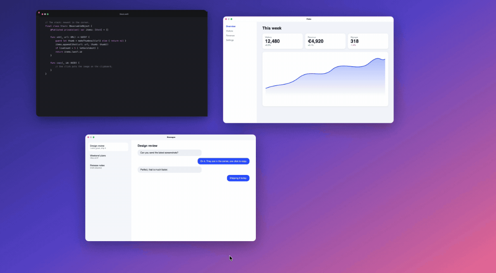

<p align="center">
  
</p>

<h1 align="center">Cornerstack</h1>

<p align="center">
  Your screenshots, stacked in the corner of the screen until you've used them.
  <br>
  Free and open source, for macOS 14 Sonoma and later.
</p>

<p align="center">
  <a href="https://github.com/nemcaya/cornerstack/releases/latest"></a>
  <a href="https://github.com/nemcaya/cornerstack/actions/workflows/build.yml"></a>
  
  <a href="LICENSE"></a>
</p>

<br>



## What it does

The macOS screenshot preview shows up for a few seconds and vanishes. Take
three screenshots in a row and only the newest is still there to grab.

Cornerstack keeps them. Every capture lands in a stack in the bottom right
corner, newest closest to the corner, and stays until you drag it somewhere
or throw it away. Nothing times out.

| | |
|:--|:--|
| Click | Copy the image. |
| <kbd>⌥</kbd> click | Copy the file's path, quoted and ready to paste into a terminal. |
| Press and hold | Open it in Markup. Screen recordings open in a trimmer. |
| Double click | Open it in its default app. |
| Force click on a trackpad | Open it in Quick Look. The left and right arrow keys step through the stack; Space or Escape closes it. |
| Drag into an app | Send a copy. It leaves the stack unless it is kept, and the file stays on disk. |
| Drag into a folder | Keep it there. It leaves the stack. |
| Drag to the Trash | Move the file to the Trash. |
| Click the cross | Remove it from the stack. The file stays where it is. |
| Click the pin | Keep the card on the stack. A kept card has no cross; click the pin again to let it go. |
| Right click | Every option, including Keep on stack, Copy Text and Quick Look. |
| <kbd>⌥</kbd>&thinsp;<kbd>⌘</kbd>&thinsp;<kbd>C</kbd> | Copy the newest card from anywhere, without touching the mouse. |
| <kbd>⌥</kbd>&thinsp;<kbd>⌘</kbd>&thinsp;<kbd>T</kbd> | Hide the stack for a while, and bring it back. |

## Details

- **Fast.** A new capture flies from where you took it into the stack in a third of a second.
- **Everywhere.** The stack shows over full screen apps. You can turn that off in Settings.
- **Out of the way.** Clicks pass through everywhere except over a card, and the stack never shows up in your screenshots.
- **Any size.** Cards fit your screen automatically. Settings (menu bar icon › *Settings…*, or open the app again) has Small, Medium and Large, and a slider for anything in between.
- **Your keys.** Change <kbd>⌥</kbd>&thinsp;<kbd>⌘</kbd>&thinsp;<kbd>C</kbd> and <kbd>⌥</kbd>&thinsp;<kbd>⌘</kbd>&thinsp;<kbd>T</kbd> in Settings, or turn them off.
- **Clean Desktop.** Say yes to *Handle screenshots* on first launch and captures, screen recordings included, go to a folder of their own instead of piling up on the Desktop. They stay there for 30 days after they leave the stack (*Open screenshots folder* in the menu bar), then move to the Trash. Drag one anywhere to keep it for good. Your previous settings come back when you quit.
- **Up to five.** Once the stack is full, a new capture pushes out the oldest card you don't keep. Large cards on a small screen fit fewer than five. Its file stays where it is.
- **Kept or put back.** The pin in a card's top right corner keeps it. Drops into apps and *Clear stack* leave a kept card in place, new captures push the other cards out first, and it has no cross, so it can't go by accident. *Put back last card* in the menu bar restores the cards that left most recently, while their files still exist.
- **Copied images too.** Switch on *Add copied images* in Settings and images you copy join the stack. Only images: anything copied along with text or a file, and anything a password manager marks as private, is left alone.
- **Text from images.** *Copy Text* copies the text in a screenshot. Apple's Vision framework reads it on your Mac, without the internet.

## How it compares

| | Where captures wait | Until you use them? | Free and open source | Better at |
|:--|:--|:--|:--|:--|
| macOS screenshot preview | Bottom right | No, a few seconds | No | Built in |
| Tendedero | A line under the menu bar | Until you remove them | Yes | 11 languages, a notarized download |
| CleanShot X / Shottr | An overlay or an editor window | Yes, or on a timer | No | Capture modes, annotation, OCR, pinning, cloud uploads |
| Dropover / Yoink | A floating shelf | Yes | No | Holding any kind of file |
| **Cornerstack** | Bottom right, where macOS shows its own preview | Yes, and a drop into an app removes the card | Yes | Showing on the display you captured on, with no network |

## Tips

- With *Add copied images* on, <kbd>⌃</kbd>&thinsp;<kbd>⇧</kbd>&thinsp;<kbd>⌘</kbd>&thinsp;<kbd>4</kbd> gives you the image on the clipboard, a file and a card in one go.
- Drag a card into a terminal, or <kbd>⌥</kbd>-click it and paste, to hand its path to command-line tools.
- *Put back last card* undoes an accidental cross or drop.
- The stack comes back after a restart.

## Privacy and permissions

- No network, accounts or analytics. Your screenshots never leave your Mac.
- Text recognition runs on your Mac.
- The clipboard is only read while *Add copied images* is on.
- If your screenshots go to the Desktop, Documents or Downloads, macOS asks for access to that folder.

## Not planned

- Capture modes or an annotation editor. Use CleanShot X or Shottr.
- A history, a library or a long stack. Five cards is the point.
- Clipboard-manager features.
- Cloud uploads or accounts.

## Install

1. Download the `.dmg` from the [latest release](https://github.com/nemcaya/cornerstack/releases/latest), open it and drag Cornerstack to Applications.
2. Open Cornerstack. It's free and open source but not notarized by Apple, so macOS says *"Cornerstack" Not Opened*. Click **Done**.
3. Open **System Settings › Privacy & Security**, scroll down to **Security** and click **Open Anyway** next to Cornerstack. Confirm with your password or Touch ID. You only do this once per version.

On macOS 14 Sonoma, right-click the app and choose **Open** instead. Or skip the prompts from Terminal:

```sh
xattr -dr com.apple.quarantine /Applications/Cornerstack.app
```

Rather not run a downloaded binary at all? [Build it yourself](#build-from-source), it takes a minute.

## Build from source

```sh
git clone https://github.com/nemcaya/cornerstack.git
cd cornerstack
scripts/build-app.sh
open build/Cornerstack.app
```

You need the Swift toolchain; Xcode is optional. With the Command Line Tools
for macOS 27, the script falls back to the macOS 26 SDK installed alongside
them, because the newer SDK needs a SwiftUI macro plugin only Xcode ships.
Local builds are signed ad hoc, so macOS asks for access to the Desktop again
after each rebuild.

`scripts/make-dmg.sh` builds the disk image for a release. It needs
[uv](https://docs.astral.sh/uv/) to run dmgbuild.

<details>
<summary>Inside the app</summary>
<br>

| Folder | File | Role |
|:--|:--|:--|
| `App` | `AppDelegate.swift` | Menu bar, shortcuts, showing and hiding the stack |
| | `FullScreen.swift` | Knows when a full screen app is up |
| | `Settings.swift` | The Settings window |
| | `HotKey.swift`, `ClosureMenuItem.swift`, `Localization.swift` | Small helpers |
| `Stack` | `Stack.swift` | What is in the stack, and what you can do with each card |
| | `StackPanel.swift` | The transparent column along the right edge of the screen |
| | `StackView.swift`, `ShotView.swift`, `Layout.swift` | The stack and its cards |
| | `GrabArea.swift` | Click, long press, drag and drop |
| | `CaptureFlight.swift` | The flight of a new capture, and the fall of a discarded one |
| | `Thumbnail.swift` | Decodes each capture once, for its card and its flight |
| `Intake` | `ScreenshotWatcher.swift` | Notices new screenshots |
| | `ClipboardWatcher.swift` | Notices images copied to the clipboard |
| | `Inbox.swift` | Takes over the screenshot settings and puts them back |
| `Editors` | `Markup.swift`, `Trim.swift` | Markup for screenshots, trimming for recordings |
| | `QuickLook.swift` | Quick Look |
| | `TextRecognition.swift` | Text recognition for Copy Text |

Text lives in `Sources/Cornerstack/Resources/<language>.lproj`. To add a
language, copy `en.lproj`, translate the values and run
`swift scripts/check-strings.swift`. The icon is drawn in code by
`scripts/make-icon.swift`.

</details>

## Why this exists

Seeing BridgeShot, the screenshot app by [BridgeMind](https://www.bridgemind.ai),
made me want one of my own. It came with their paid plans, so I made a free,
open source one instead.

Cornerstack began as a fork of [Tendedero](https://github.com/alejandrobujan/tendedero)
by Alejandro Buján, a lovely app that hangs your screenshots on a line under
the menu bar. I wanted the same idea in the place macOS already puts its own
screenshot preview, so I reworked how it looks and behaves:

- a stack in the bottom right corner instead of a line along the top, with the newest capture nearest the corner;
- no menu bar reveal and no auto-hide: the stack stays until you deal with every capture;
- dragging a capture into an app removes it from the stack, since you rarely need it twice;
- a fix for drags that never report their end, which could freeze the stack;
- shown over full screen apps and left out of new screenshots, with a faster flight animation.

The original idea and most of the groundwork are Alejandro's. If you prefer
the line, [use Tendedero](https://github.com/alejandrobujan/tendedero).

## License

[MIT](LICENSE), including Alejandro Buján's original work. The Tendedero
name and icon are not covered by it and are not used here, see
[NOTICE](NOTICE.md). Cornerstack is an independent project and is not
affiliated with Tendedero.
