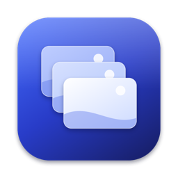
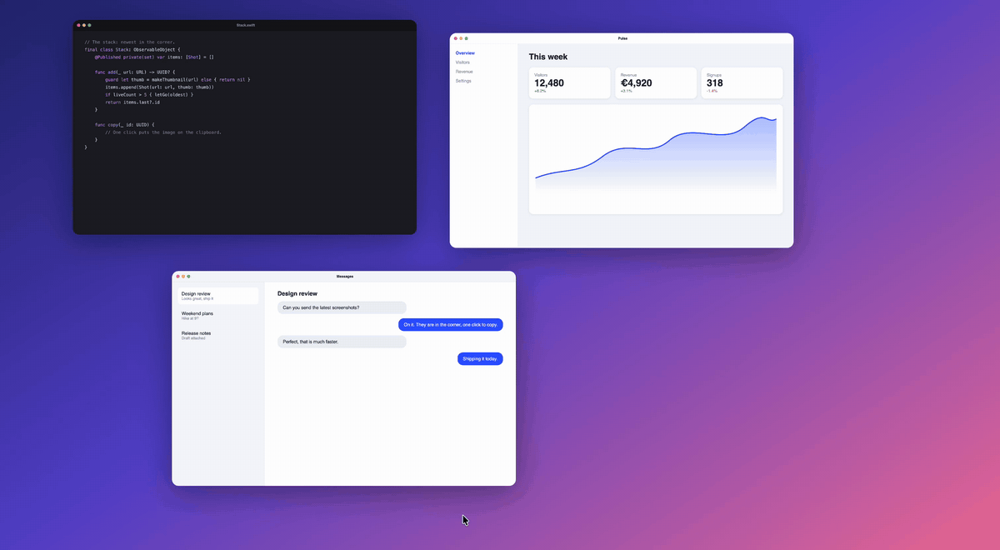

<p align="center">
  
</p>

<h1 align="center">Cornerstack</h1>

<p align="center">
  Your screenshots, stacked in the corner of the screen until you've used them.
  <br>
  Free and open source, for macOS 14 Sonoma and later.
</p>

<p align="center">
  <a href="https://github.com/Slover-69/cornerstack/releases/latest"></a>
  <a href="https://github.com/Slover-69/cornerstack/actions/workflows/build.yml"></a>
  
  <a href="LICENSE"></a>
</p>

<br>



## What it does

The macOS screenshot preview shows up for a few seconds and vanishes. Take
three screenshots in a row and only the newest is still there to grab.

Cornerstack keeps them. Every capture lands in a stack in the bottom right
corner, newest closest to the corner, and stays until you drag it somewhere
or throw it away. Nothing times out.

| | |
|:--|:--|
| Click | Copy the image. |
| Press and hold | Open it in Markup. Screen recordings open in a trimmer. |
| Double click | Open it in its default app. |
| Drag into an app | Send a copy. It leaves the stack, and the file stays on disk. |
| Drag into a folder | Keep it there. It leaves the stack. |
| Drag to the Trash | Move the file to the Trash. |
| Click the cross | Remove it from the stack. Captures in Cornerstack's own folder go to the Trash. |
| Right click | Every option, including Show in Finder. |
| <kbd>⌃</kbd>&thinsp;<kbd>⌥</kbd>&thinsp;<kbd>T</kbd> | Show or hide the stack. |

## Details

- **Fast.** A new capture flies from where you took it into the stack in a third of a second.
- **Everywhere.** The stack shows over full screen apps. You can turn that off in the menu bar.
- **Out of the way.** Clicks pass through everywhere except over a card, and the stack never shows up in your screenshots.
- **Clean Desktop.** Say yes to *Handle screenshots* on first launch and captures, screen recordings included, go to a folder of their own instead of piling up on the Desktop. Your previous settings come back when you quit.
- **Up to five.** A sixth capture pushes the oldest out of the stack. Its file stays where it is, and *Open screenshots folder* in the menu bar takes you there.
- **Copied images too.** Switch on *Add copied images* and images you copy join the stack. Only images: anything copied along with text or a file, and anything a password manager marks as private, is left alone.
- **Private.** No account, no network, no analytics. Your screenshots never leave your Mac.

## Install

1. Download the `.dmg` from the [latest release](https://github.com/Slover-69/cornerstack/releases/latest), open it and drag Cornerstack to Applications.
2. Open Cornerstack. It's free and open source but not notarized by Apple, so macOS says *"Cornerstack" Not Opened*. Click **Done**.
3. Open **System Settings › Privacy & Security**, scroll down to **Security** and click **Open Anyway** next to Cornerstack. Confirm with your password or Touch ID. You only do this once per version.

On macOS 14 Sonoma, right-click the app and choose **Open** instead. Or skip the prompts from Terminal:

```sh
xattr -dr com.apple.quarantine /Applications/Cornerstack.app
```

Rather not run a downloaded binary at all? [Build it yourself](#build-from-source), it takes a minute.

## Build from source

```sh
git clone https://github.com/Slover-69/cornerstack.git
cd cornerstack
scripts/build-app.sh
open build/Cornerstack.app
```

You need the Swift toolchain; Xcode is optional. With the Command Line Tools
for macOS 27, the script falls back to the macOS 26 SDK installed alongside
them, because the newer SDK needs a SwiftUI macro plugin only Xcode ships.
Local builds are signed ad hoc, so macOS asks for access to the Desktop again
after each rebuild.

`scripts/make-dmg.sh` builds the disk image for a release. It needs
[uv](https://docs.astral.sh/uv/) to run dmgbuild.

<details>
<summary>Inside the app</summary>
<br>

| Folder | File | Role |
|:--|:--|:--|
| `App` | `AppDelegate.swift` | Menu bar, shortcut, showing and hiding the stack |
| | `FullScreen.swift` | Knows when a full screen app is up |
| | `HotKey.swift`, `ClosureMenuItem.swift`, `Localization.swift` | Small helpers |
| `Stack` | `Stack.swift` | What is in the stack, and what you can do with each card |
| | `StackPanel.swift` | The transparent column along the right edge of the screen |
| | `StackView.swift`, `ShotView.swift`, `Layout.swift` | The stack and its cards |
| | `GrabArea.swift` | Click, long press, drag and drop |
| | `CaptureFlight.swift` | The flight of a new capture, and the fall of a discarded one |
| | `Thumbnail.swift` | The small images on the cards |
| `Intake` | `ScreenshotWatcher.swift` | Notices new screenshots |
| | `ClipboardWatcher.swift` | Notices images copied to the clipboard |
| | `Inbox.swift` | Takes over the screenshot settings and puts them back |
| `Editors` | `Markup.swift`, `Trim.swift` | Markup for screenshots, trimming for recordings |

Text lives in `Sources/Cornerstack/Resources/<language>.lproj`. To add a
language, copy `en.lproj`, translate the values and run
`swift scripts/check-strings.swift`. The icon is drawn in code by
`scripts/make-icon.swift`.

</details>

## Why this exists

Cornerstack began as a fork of [Tendedero](https://github.com/alejandrobujan/tendedero)
by Alejandro Buján, a lovely app that hangs your screenshots on a line under
the menu bar. I wanted the same idea in the place macOS already puts its own
screenshot preview, so I reworked how it looks and behaves:

- a stack in the bottom right corner instead of a line along the top, with the newest capture nearest the corner;
- no menu bar reveal and no auto-hide: the stack stays until you deal with every capture;
- dragging a capture into an app removes it from the stack, since you rarely need it twice;
- a fix for drags that never report their end, which could freeze the stack;
- shown over full screen apps and left out of new screenshots, with a faster flight animation.

The original idea and most of the groundwork are Alejandro's. If you prefer
the line, [use Tendedero](https://github.com/alejandrobujan/tendedero).

## License

[MIT](LICENSE), including Alejandro Buján's original work. The Tendedero
name and icon are not covered by it and are not used here, see
[NOTICE](NOTICE.md). Cornerstack is an independent project and is not
affiliated with Tendedero.
